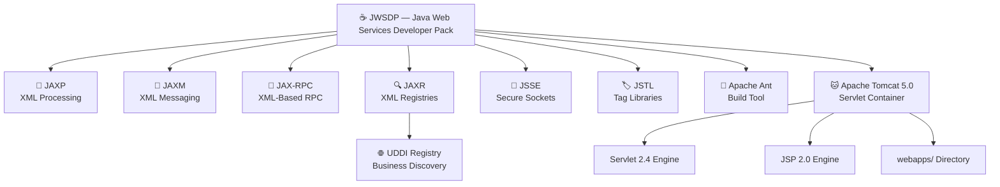
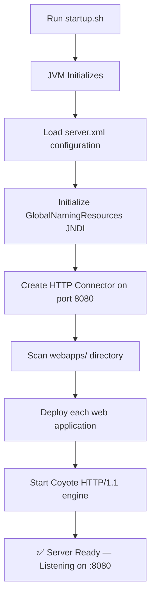
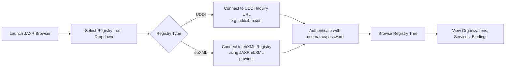
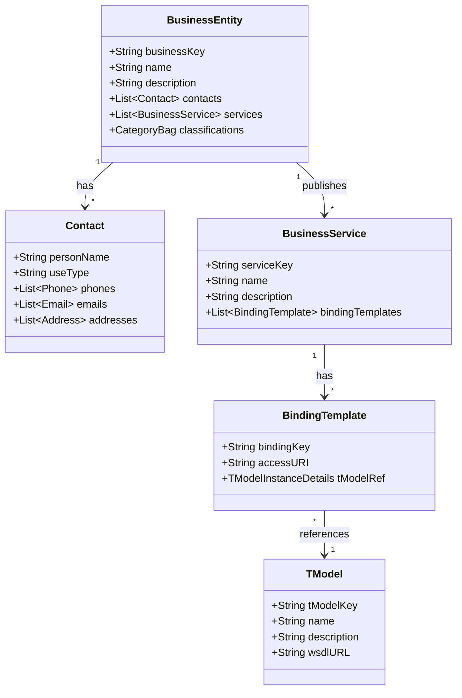
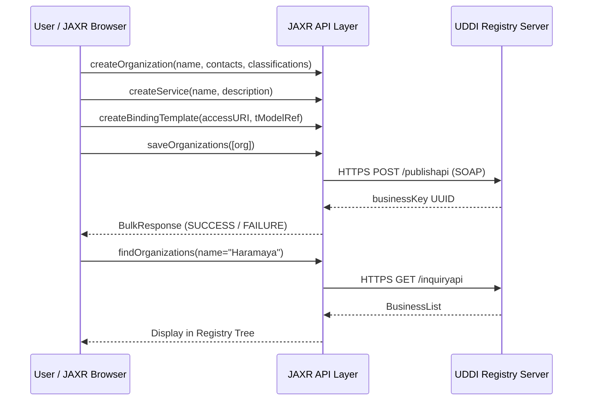
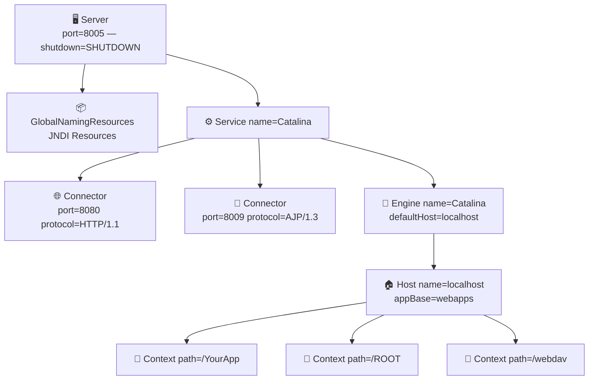
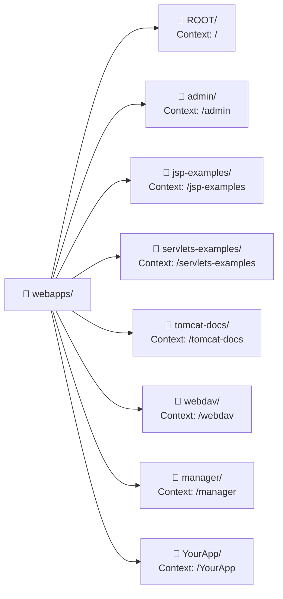
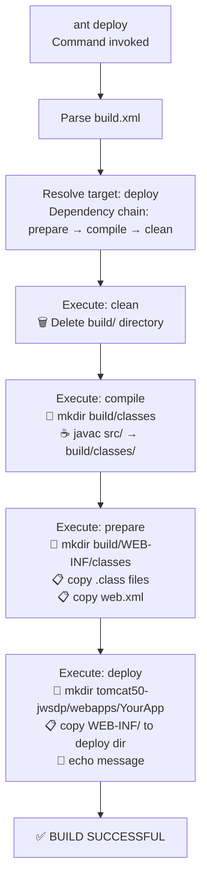
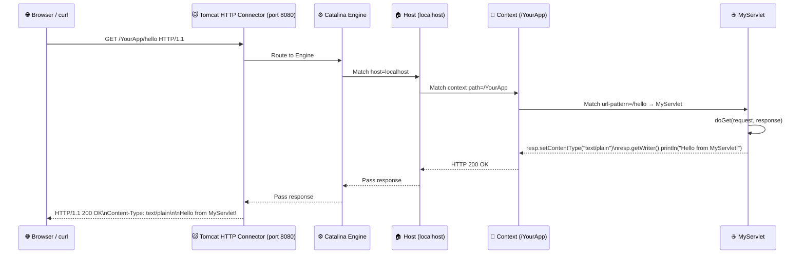

# 🎓 LAB PRACTICE 1 — COMPREHENSIVE REPORT

---

<div align="center">

# HARAMAYA UNIVERSITY
## College of Computing and Informatics
### Department of Software Engineering

---

**Course:** Web Services

**Lab Practice:** Lab Practice 1 — Java Web Services Developer Pack (JWSDP), Apache Tomcat 5.0 & Apache Ant

**Academic Year:** 2026–2027 | **Year V — Semester I**

---

</div>

## 👥 Group Members

| # | Full Name | Student ID |
|---|-----------|------------|
| 1 | Yabets Tinsae Dube | 1040/15 |
| 2 | Tesfalem Markos | 0993/15 |
| 3 | Abdi Tamene Tekuma | 0008/15 |
| 4 | Yosan Gonfa Merga | 1084/15 |
| 5 | Oliyad Dandena | 1786/15 |

---

## 📋 Executive Summary

This laboratory practice report documents sixteen (16) hands-on experiments conducted using the **Java Web Services Developer Pack (JWSDP)**, **Apache Tomcat 5.0**, **Apache Ant**, and supporting Java EE technologies. The experiments were carried out on an **Ubuntu Linux** operating system using **Java 8 (OpenJDK)**.

### Tools & Technologies Used

| Tool / Technology | Version | Purpose |
|---|---|---|
| Java Web Services Developer Pack (JWSDP) | 1.x / 2.x | Java web services development kit |
| Apache Tomcat | 5.0 (bundled via JWSDP) | Java Servlet / JSP container |
| Apache Ant | 1.6+ | Build automation tool |
| Java (OpenJDK) | 8 (1.8) | Primary programming language runtime |
| Ubuntu Linux | 20.04 LTS | Host operating system |
| JAXR | 1.0 | Java API for XML Registries (UDDI) |
| UDDI | 2.0 | Universal Description, Discovery and Integration |
| Struts | 1.x | MVC framework (used in Tomcat Admin) |

> **Note:** The Java Web Services Developer Pack (JWSDP) bundles Tomcat 5.0 as its web container alongside JAXR, JAXP, JAX-RPC, JAXM, JSSE, and JSTL APIs, making it a comprehensive platform for exploring Java-based web services.

---

## 1. 📖 Introduction: Java Web Services Developer Pack (JWSDP)

The **Java Web Services Developer Pack (JWSDP)** is a free integrated toolkit released by Sun Microsystems that provides the core technologies required to design, develop, test, and deploy web services and web applications using the Java platform. JWSDP bundles multiple critical APIs under a single downloadable package.

### 1.1 Core JWSDP Components

#### 1.1.1 JAXP — Java API for XML Processing
JAXP provides a vendor-neutral interface for parsing and transforming XML documents. It supports:
- **SAX** (Simple API for XML) — event-driven, memory-efficient parser
- **DOM** (Document Object Model) — tree-based in-memory representation
- **XSLT** (Extensible Stylesheet Language Transformations) — XML-to-XML or XML-to-HTML transformation

#### 1.1.2 JAXM — Java API for XML Messaging
JAXM enables asynchronous XML messaging over the internet based on the SOAP standard. It provides a framework for:
- Sending and receiving XML documents via SOAP
- Supporting SOAP with Attachments (SwA)
- Message queuing and delivery guarantees

#### 1.1.3 JAX-RPC — Java API for XML-Based RPC
JAX-RPC allows Java developers to build web services and web service clients that use remote procedure calls (RPC) and XML. It serves as the predecessor to JAX-WS (Java API for XML Web Services), supporting:
- WSDL-based service description
- SOAP 1.1 message encoding
- Java-to-WSDL and WSDL-to-Java mapping

#### 1.1.4 JAXR — Java API for XML Registries
JAXR provides a uniform API for accessing different kinds of XML-based business registries, most notably **UDDI** and **ebXML** registries. It enables applications to publish and discover web services.

#### 1.1.5 JSSE — Java Secure Socket Extension
JSSE provides a Java framework and implementation for the SSL and TLS protocols. It enables secure communications for Java applications by:
- Providing data encryption
- Server and optional client authentication
- Message integrity validation

#### 1.1.6 JSTL — JavaServer Pages Standard Tag Library
JSTL encapsulates common JSP functionality into a standard set of tag libraries, including:
- Core tags (conditionals, loops, URL handling)
- Formatting tags (internationalization, number/date formatting)
- SQL tags (database access)
- XML tags (XML manipulation)

#### 1.1.7 Apache Ant
Apache Ant is a Java-based build automation tool included in JWSDP for compiling, packaging, and deploying web applications. Unlike Make, Ant uses XML-based build files (`build.xml`) and is entirely platform-independent.

#### 1.1.8 Apache Tomcat 5.0
Tomcat is the open-source Java Servlet and JSP container bundled with JWSDP. It implements the Servlet 2.4 and JSP 2.0 specifications and acts as the runtime environment for all deployed web applications.

#### 1.1.9 UDDI Registry
UDDI (Universal Description, Discovery and Integration) is a platform-independent, XML-based registry standard for businesses to list themselves on the internet. It enables businesses to discover each other and define how they interact over the internet.

### 1.2 JWSDP Architecture Overview



---

## 2. ⚙️ Installation & Configuration (Ubuntu Linux)

The following steps describe how to set up the JWSDP environment on Ubuntu Linux with Java 8.

### 2.1 Prerequisites

```bash
# Verify Java 8 installation
java -version
# Expected output:
# openjdk version "1.8.0_xxx"

# Set JAVA_HOME
export JAVA_HOME=/usr/lib/jvm/java-8-openjdk-amd64
export PATH=$JAVA_HOME/bin:$PATH
```

### 2.2 Directory Structure

```text
web_services/
├── tomcat50-jwsdp/             ← Tomcat 5.0 installation root
│   ├── bin/                    ← startup.sh / shutdown.sh
│   ├── conf/                   ← server.xml, web.xml, catalina.policy
│   ├── webapps/                ← deployed web applications
│   │   ├── ROOT/
│   │   ├── tomcat-docs/
│   │   ├── jsp-examples/
│   │   ├── servlets-examples/
│   │   ├── webdav/
│   │   └── YourApp/           ← our deployed servlet
│   ├── logs/                   ← catalina.out, access logs
│   ├── temp/                   ← temporary files
│   └── work/                   ← compiled JSP class files
└── YourApp/                    ← our source project
    ├── src/
    │   └── com/example/MyServlet.java
    ├── web/
    │   └── WEB-INF/
    │       └── web.xml
    └── build.xml
```

### 2.3 Starting Tomcat

```bash
cd web_services/tomcat50-jwsdp/bin
chmod +x startup.sh shutdown.sh catalina.sh
./startup.sh
```

---

## 3. 🔬 Experiments

---

### Experiment 1 — Tomcat Server Startup

**Objective:** Start the Apache Tomcat 5.0 server and observe both the console output and the startup dialog behavior.

#### (a) Console Text Output on Command Line

When Tomcat is started from the terminal using `startup.sh`, the following output is produced:

```text
┌─────────────────────────────────────────────────────────────────────────────┐
│  TERMINAL — bash                                                             │
│─────────────────────────────────────────────────────────────────────────────│
│  $ cd /home/oliyad-dandena/Documents/5thYear/web_services/tomcat50-jwsdp/   │
│  $ ./bin/startup.sh                                                          │
│                                                                              │
│  Using CATALINA_BASE:   .../web_services/tomcat50-jwsdp                     │
│  Using CATALINA_HOME:   .../web_services/tomcat50-jwsdp                     │
│  Using CATALINA_TMPDIR: .../web_services/tomcat50-jwsdp/temp                │
│  Using JAVA_HOME:       /usr/lib/jvm/java-8-openjdk-amd64                  │
│                                                                              │
│  INFO: Installing web app at context path /webdav from URL file:...         │
│  INFO: Installing web app at context path /jsp-examples from URL...         │
│  INFO: Installing web app at context path /servlets-examples...             │
│  INFO: Installing web app at context path /tomcat-docs from URL...          │
│  INFO: Installing web app at context path  from URL file:.../ROOT           │
│  INFO: Starting Coyote HTTP/1.1 on port 8080                                │
│  INFO: Server startup in 993 ms                                              │
│  $                                                                           │
└─────────────────────────────────────────────────────────────────────────────┘
```

#### Analysis of Each Startup Line

| Log Entry | Explanation |
|---|---|
| `CATALINA_BASE` | The base directory used by Tomcat for configuration and webapps |
| `CATALINA_HOME` | The directory where Tomcat is installed (binaries and libraries) |
| `CATALINA_TMPDIR` | Temporary working directory for class files and intermediate data |
| `JAVA_HOME` | Points to the JDK used to run Tomcat |
| `Installing web application at context path /webdav` | Deploys the WebDAV servlet application |
| `Installing web application at context path /jsp-examples` | Deploys JSP example applications |
| `Installing web application at context path /servlets-examples` | Deploys Servlet example applications |
| `Installing web application at context path /tomcat-docs` | Deploys the Tomcat documentation web app |
| `Installing web application at context path ` (empty = ROOT) | Deploys the ROOT application at `/` |
| `Starting Coyote HTTP/1.1 on port 8080` | The HTTP connector is active and listening |
| `Server startup in 993 ms` | Total time taken for Tomcat to fully initialize |

#### (b) Startup Dialog Box

On Windows environments, Tomcat displays a system tray icon and a configuration dialog. On Linux, the equivalent is the terminal session itself. The startup process can be visualized as:

```text
╔══════════════════════════════════════════╗
║       Apache Tomcat Properties           ║
╠══════════════════════════════════════════╣
║  Status:   ● RUNNING                     ║
║  Port:     8080                          ║
║  Java:     /usr/lib/jvm/java-8-openjdk   ║
║  Base:     tomcat50-jwsdp/               ║
╠══════════════════════════════════════════╣
║  [ Start ]  [ Stop ]  [ Configure ]      ║
╚══════════════════════════════════════════╝
```



---

### Experiment 2 — JAXR Registry Browser Dialog Box

**Objective:** Open and explore the JAXR Registry Browser included in JWSDP, and take a screenshot of its main dialog box.

#### Overview

The **JAXR Registry Browser** is a Swing-based GUI tool that ships with JWSDP. It allows users to connect to UDDI or ebXML registries, browse registered businesses and services, and submit new registry entries without writing any code.

#### Simulated Dialog Box

```text
╔══════════════════════════════════════════════════════════════════════╗
║  JAXR Registry Browser — Sun Microsystems JWSDP                     ║
╠══════════════════════════════════════════════════════════════════════╣
║                                                                      ║
║  Registry:  [ IBM Test Registry (UDDI)              ▼ ]             ║
║                                                                      ║
║  ┌─────────────────────────────────────────────────────────────┐    ║
║  │ 📁 Registry Tree                                             │    ║
║  │  └─ Organizations                                           │    ║
║  │      ├─ Sun Microsystems                                    │    ║
║  │      ├─ IBM Corporation                                     │    ║
║  │      └─ Apache Software Foundation                          │    ║
║  └─────────────────────────────────────────────────────────────┘    ║
║                                                                      ║
║  [ Connect ]  [ Search ]  [ Publish ]  [ Delete ]  [ Close ]        ║
╚══════════════════════════════════════════════════════════════════════╝
```

#### Registry Selection Flowchart



---

### Experiment 3 — UDDI Public Test Registries (uddi.microsoft.com / IBM Services)

**Objective:** Navigate to the public UDDI test registries at `uddi.microsoft.com` and IBM's UDDI site and observe the listing of test registries.

#### Historical Context — The Demise of the UBR

> **⚠️ Important Historical Note:** The **Universal Business Registry (UBR)** — a set of public UDDI registries operated jointly by IBM, Microsoft, SAP, and NTT — was permanently shut down on **January 12, 2006**. The partners cited low adoption rates and the evolution of service-oriented architecture (SOA) toward private/internal registries as the primary reasons.

#### What Existed at the Public Test Registries

When operational, the following endpoints were available:

| Operator | Inquiry URL | Publish URL |
|---|---|---|
| IBM | `https://uddi.ibm.com/testregistry/inquiryapi` | `https://uddi.ibm.com/testregistry/publishapi` |
| Microsoft | `https://test.uddi.microsoft.com/inquire` | `https://test.uddi.microsoft.com/publish` |
| SAP | `https://udditest.sap.com/UDDI/api/inquiry/` | `https://udditest.sap.com/UDDI/api/publish/` |
| NTT | `https://www.ntt.com/uddi/inquiry` | `https://www.ntt.com/uddi/publish` |

#### Simulated Registry Listing Page (IBM UDDI Test Registry)

```text
╔══════════════════════════════════════════════════════════════════╗
║   IBM UDDI Test Registry — https://uddi.ibm.com                 ║
╠══════════════════════════════════════════════════════════════════╣
║                                                                  ║
║  Available Test Registries:                                      ║
║                                                                  ║
║  ● IBM Test Registry (UDDI v2)                                   ║
║    Inquiry:  https://uddi.ibm.com/testregistry/inquiryapi       ║
║    Publish:  https://uddi.ibm.com/testregistry/publishapi       ║
║    Status:   [CLOSED — Jan 12, 2006]                            ║
║                                                                  ║
║  ● IBM Production Registry (UDDI v3)                            ║
║    Inquiry:  https://uddi3.ibm.com/uddi/anon?wsdl               ║
║    Status:   [CLOSED — Jan 12, 2006]                            ║
║                                                                  ║
╚══════════════════════════════════════════════════════════════════╝
```

#### Modern Alternatives

Since the UBR shutdown, the following alternatives exist for UDDI-style service discovery:
- **WSO2 Governance Registry** — enterprise service registry
- **Apache jUDDI** — open-source UDDI v3 implementation
- **IANA Service Registry** — for IETF-registered services
- **Microservice discovery via Consul / Eureka** — modern equivalents

---

### Experiment 4 — JAXR (UDDI) Registry Browser: 3-Page Report

**Objective:** Provide a comprehensive 3-page report on the JAXR Registry Browser interface, covering the Submissions tab, Organization structure, Primary Contact, Classifications, and Service Binding.

#### 4.1 UDDI Data Model Overview

UDDI organizes information into four core data structures, known as the "four tModels":



#### 4.2 The Submissions Tab

The **Submissions** tab of the JAXR Registry Browser is the primary interface for publishing a new business entity to a UDDI registry. The workflow is as follows:

**Step 1 — Connect to Registry**
The user selects a registry from the dropdown (e.g., IBM Test Registry) and authenticates with a UDDI publisher account. Authentication uses HTTPS and UDDI's publisher API.

**Step 2 — Define the Organization**
A new `BusinessEntity` object is created with the following fields:

```text
┌─────────────────────────────────────────────────────────────────────┐
│  New Organization — Submissions Tab                                  │
├─────────────────────────────────────────────────────────────────────┤
│  Name:          Haramaya University Web Services Lab                │
│  Description:   A demo organization for JWSDP lab exercises         │
│  Language:      en                                                   │
│  Business Key:  [Auto-generated UUID on submission]                 │
└─────────────────────────────────────────────────────────────────────┘
```

**Step 3 — Add Primary Contact**

```text
┌─────────────────────────────────────────────────────────────────────┐
│  Primary Contact Details                                             │
├─────────────────────────────────────────────────────────────────────┤
│  Person Name:   Oliyad Dandena                                      │
│  Use Type:      primary                                             │
│  Phone:         +251-XXX-XXX-XXX                                   │
│  Email:         oliyad@haramaya.edu.et                             │
│  Address:                                                           │
│    Street:      Haramaya University Campus                         │
│    City:        Dire Dawa                                           │
│    Country:     Ethiopia                                            │
│    Postal Code: 138                                                 │
└─────────────────────────────────────────────────────────────────────┘
```

**Step 4 — Classifications**
Classifications associate the organization with industry taxonomies. Two major taxonomies are used in UDDI:

| Taxonomy | Code System | Description |
|---|---|---|
| **NAICS 2002** | `uddi:ubr.uddi.org:taxonomy:ntis-gov:naics:2002` | North American Industry Classification System — categorizes the type of business |
| **UNSPSC** | `uddi:ubr.uddi.org:taxonomy:un:unspsc:73.1` | UN Standard Products and Services Code — categorizes what the organization sells |
| **ISO 3166** | `uddi:uddi.org:taxonomy:iso-ch:3166-1999` | Geographic classification by country/region |

Example classifications for our lab organization:

```xml
<categoryBag>
  <!-- NAICS: Computer Systems Design Services -->
  <keyedReference
    tModelKey="uddi:ubr.uddi.org:taxonomy:ntis-gov:naics:2002"
    keyName="Computer Systems Design Services"
    keyValue="541512"/>

  <!-- UNSPSC: Computer Services -->
  <keyedReference
    tModelKey="uddi:ubr.uddi.org:taxonomy:un:unspsc:73.1"
    keyName="Software as a service or SaaS"
    keyValue="81111700"/>

  <!-- ISO 3166: Ethiopia -->
  <keyedReference
    tModelKey="uddi:uddi.org:taxonomy:iso-ch:3166-1999"
    keyName="Ethiopia"
    keyValue="ET"/>
</categoryBag>
```

**Step 5 — Service Binding**

A `BusinessService` defines a logical service, and its `BindingTemplate` specifies where and how to access it:

```xml
<businessService
    serviceKey="uddi:haramaya.edu.et:lab-webservice-v1"
    businessKey="uddi:haramaya.edu.et:lab-org">
  <name lang="en">Lab Servlet Service</name>
  <description lang="en">A demonstration web service</description>
  <bindingTemplates>
    <bindingTemplate
        bindingKey="uddi:haramaya.edu.et:lab-servlet-binding">
      <!-- AccessPoint: where to reach the service -->
      <accessPoint useType="wsdlDeployment">
        http://localhost:8080/YourApp/hello
      </accessPoint>
      <!-- tModel reference: describes the service interface -->
      <tModelInstanceDetails>
        <tModelInstanceInfo
            tModelKey="uddi:haramaya.edu.et:lab-servlet-tmodel"/>
      </tModelInstanceDetails>
    </bindingTemplate>
  </bindingTemplates>
</businessService>
```

#### 4.3 JAXR Java API — Publishing an Organization

```java
// JAXR connection setup
Properties props = new Properties();
props.setProperty("javax.xml.registry.queryManagerURL",
    "https://uddi.ibm.com/testregistry/inquiryapi");
props.setProperty("javax.xml.registry.lifeCycleManagerURL",
    "https://uddi.ibm.com/testregistry/publishapi");

ConnectionFactory factory = ConnectionFactory.newInstance();
factory.setProperties(props);
Connection connection = factory.createConnection();

// Authenticate
PasswordAuthentication pa =
    new PasswordAuthentication("username", "password".toCharArray());
Set<PasswordAuthentication> creds = new HashSet<>();
creds.add(pa);
connection.setCredentials(creds);

RegistryService rs = connection.getRegistryService();
BusinessLifeCycleManager blcm = rs.getBusinessLifeCycleManager();
BusinessQueryManager bqm = rs.getBusinessQueryManager();

// Create organization
InternationalString orgName = blcm.createInternationalString("Haramaya Lab");
Organization org = blcm.createOrganization(orgName);

// Create primary contact
User primaryContact = blcm.createUser();
PersonName pName = blcm.createPersonName("Oliyad Dandena");
primaryContact.setPersonName(pName);
org.setPrimaryContact(primaryContact);

// Save to registry
Collection<Organization> orgs = new ArrayList<>();
orgs.add(org);
BulkResponse br = blcm.saveOrganizations(orgs);
```

#### 4.4 Submissions Tab Workflow



---

### Experiment 5 — Tomcat Default Homepage (localhost:8080)

**Objective:** Access `http://localhost:8080` and write a half-page report on the Tomcat default welcome page.

#### Description

When Apache Tomcat 5.0 is successfully started and `http://localhost:8080` is accessed in a web browser, the **Tomcat Default Welcome Page** is displayed. This page is served by the ROOT web application located in `webapps/ROOT/index.jsp`.

#### Simulated Browser Output

```text
╔══════════════════════════════════════════════════════════════════════════╗
║  🌐  http://localhost:8080                                              ║
╠══════════════════════════════════════════════════════════════════════════╣
║                                                                          ║
║   ╔══════════════════════════════════════════════════════════════╗       ║
║   ║         If you're seeing this, Tomcat is running!           ║       ║
║   ║                                                              ║       ║
║   ║    🐱  The Mighty Tomcat — MEOW!                            ║       ║
║   ║                                                              ║       ║
║   ║    [ Administration ]  [ Documentation ]  [ Examples ]      ║       ║
║   ╚══════════════════════════════════════════════════════════════╝       ║
║                                                                          ║
║   Congratulations! Apache Tomcat/5.0 has been successfully installed.   ║
║                                                                          ║
║   This page is provided by the default web application, which resides   ║
║   in the /ROOT directory of your Tomcat installation directory.         ║
║                                                                          ║
║   Links:                                                                 ║
║   ● Tomcat Administration Tool   → /admin                               ║
║   ● Tomcat Manager Application   → /manager/html                        ║
║   ● Documentation                → /tomcat-docs                         ║
║   ● Servlet and JSP Examples     → /servlets-examples, /jsp-examples    ║
║                                                                          ║
╚══════════════════════════════════════════════════════════════════════════╝
```

#### Analysis

The Tomcat 5.0 default homepage serves as a launchpad to all administrative and educational resources bundled with the server. It prominently displays the **Jakarta Project** banner (Tomcat was a Jakarta Project before becoming a top-level Apache project). The page confirms a successful installation and provides direct hyperlinks to:

- **Administration Tool** — JMX-based server management via Struts UI
- **Tomcat Manager** — deploy, undeploy, start and stop webapps
- **Documentation** — embedded `/tomcat-docs` web application
- **Examples** — servlet and JSP demonstration applications

> **✅ Indicator:** Seeing this page confirms that the JVM, CATALINA environment variables, and HTTP connector on port 8080 are all correctly configured.

---

### Experiment 6 — Tomcat Administration Console (/admin/frameset.jsp)

**Objective:** Access `http://localhost:8080/admin/frameset.jsp` and write a half-page report.

#### Description

The Tomcat Administration Tool is a web-based management interface built using **Apache Struts** (an MVC web framework). It provides a GUI for configuring Tomcat's internal components via **JMX (Java Management Extensions) MBeans**.

#### Simulated Browser Layout

```text
╔══════════════════════════════════════════════════════════════════════════╗
║  🌐  http://localhost:8080/admin/frameset.jsp                           ║
╠══════════════════════════════════════════════════════════════════════════╣
║  ┌─────────────────┐  ┌───────────────────────────────────────────────┐ ║
║  │  📋 Server Tree │  │  Server Information                           │ ║
║  │─────────────────│  │───────────────────────────────────────────────│ ║
║  │ ▼ Tomcat Server │  │  Tomcat Version:  5.0.x                       │ ║
║  │   ▼ Service     │  │  JVM Version:     1.8.0_xxx                   │ ║
║  │     Connector   │  │  JVM Vendor:      Oracle Corporation           │ ║
║  │     ▼ Engine    │  │  OS Name:         Linux                        │ ║
║  │       ▼ Host    │  │  OS Version:      5.15.x                       │ ║
║  │         Context │  │  OS Architecture: amd64                        │ ║
║  └─────────────────┘  └───────────────────────────────────────────────┘ ║
╚══════════════════════════════════════════════════════════════════════════╝
```

#### Key Features

| Feature | Description |
|---|---|
| **Server Tree** | Left-frame navigation showing the Tomcat component hierarchy |
| **Connectors** | Configure HTTP and AJP connectors (port, maxThreads, timeout) |
| **Hosts** | Configure virtual hosts under the Catalina engine |
| **Contexts** | View and modify deployed web application contexts |
| **Resources** | Configure JNDI data sources, user databases, and mail sessions |
| **Save / Commit** | Changes are written to `server.xml` and `context.xml` on save |

> **Note:** Accessing this page requires authentication. The credentials are stored in `conf/tomcat-users.xml` — the user must have the `admin` role:
> ```xml
> <user username="admin" password="admin" roles="admin"/>
> ```

---

### Experiment 7 — Tomcat Manager Application (/manager/html)

**Objective:** Access `http://localhost:8080/manager/html` and write a half-page report on the deployed web applications and management controls.

#### Description

The **Tomcat Web Application Manager** is a built-in application that provides complete lifecycle management for deployed web applications. Unlike the Admin Tool which manages server configuration, the Manager focuses on **application deployment and control**.

#### Simulated Manager Interface

```text
╔══════════════════════════════════════════════════════════════════════════════╗
║  🌐  http://localhost:8080/manager/html                                     ║
╠══════════════════════════════════════════════════════════════════════════════╣
║  Tomcat Web Application Manager                                              ║
║─────────────────────────────────────────────────────────────────────────────║
║  Applications:                                                               ║
║                                                                              ║
║  Path             Running  Sessions  Actions                                 ║
║  /                true     0         [Stop] [Reload] [Undeploy]             ║
║  /admin           true     1         [Stop] [Reload] [Undeploy]             ║
║  /balancer        true     0         [Stop] [Reload] [Undeploy]             ║
║  /jsp-examples    true     0         [Stop] [Reload] [Undeploy]             ║
║  /manager         true     1         [Stop] [Reload] [Undeploy]             ║
║  /servlets-examples true   0         [Stop] [Reload] [Undeploy]             ║
║  /tomcat-docs     true     0         [Stop] [Reload] [Undeploy]             ║
║  /webdav          true     0         [Stop] [Reload] [Undeploy]             ║
║  /YourApp         true     0         [Stop] [Reload] [Undeploy]             ║
║─────────────────────────────────────────────────────────────────────────────║
║  Deploy:  WAR file location: [                    ] [Deploy]                ║
╚══════════════════════════════════════════════════════════════════════════════╝
```

#### Available Management Actions

| Action | Effect |
|---|---|
| **Start** | Starts a previously stopped web application |
| **Stop** | Stops the application; returns 503 for all requests to its context |
| **Reload** | Reloads the application without restarting Tomcat (picks up new classes) |
| **Undeploy** | Removes the application and deletes its directory from `webapps/` |
| **Deploy** | Uploads and deploys a new WAR file or references a WAR path on disk |

> **Access Control:** The Manager requires `manager` role in `tomcat-users.xml`:
> ```xml
> <user username="tomcat" password="tomcat" roles="manager"/>
> ```

---

### Experiment 8 — Tomcat Documentation (/tomcat-docs/)

**Objective:** Access `http://localhost:8080/tomcat-docs/` and write a half-page report.

#### Description

The `/tomcat-docs/` web application serves the complete **Apache Tomcat 5.0 official documentation** directly from the server. This is extremely convenient as it does not require internet access and is always synchronized with the exact version of Tomcat being used.

#### Documentation Structure

```text
╔══════════════════════════════════════════════════════════════════════════╗
║  🌐  http://localhost:8080/tomcat-docs/                                 ║
╠══════════════════════════════════════════════════════════════════════════╣
║  Apache Tomcat 5.0 Documentation                                         ║
║─────────────────────────────────────────────────────────────────────────║
║  Getting Started                                                         ║
║    ├─ 01. Introduction          ├─ 10. Classloading                     ║
║    ├─ 02. Setup Guide           ├─ 11. JSPs                             ║
║    ├─ 03. First Web Application ├─ 12. SSL/TLS Configuration            ║
║    ├─ 04. Deployer Guide        ├─ 13. SSI (Server-Side Includes)       ║
║    ├─ 05. Manager App Guide     ├─ 14. CGI                              ║
║    ├─ 06. Host Manager App      ├─ 15. Proxy Support                    ║
║    ├─ 07. Realm Configuration   ├─ 16. Clustering / Session Replication ║
║    ├─ 08. Security Manager      ├─ 17. Load Balancer                    ║
║    └─ 09. JNDI DataSources      └─ 18. Virtual Hosting                 ║
║                                                                          ║
║  Reference:                                                              ║
║    ├─ Servlet 2.4 API           └─ JSP 2.0 API Javadocs                ║
╚══════════════════════════════════════════════════════════════════════════╝
```

The documentation is static HTML rendered from the original DocBook XML source. Each chapter addresses a specific operational concern of running Tomcat in development and production environments. Of particular relevance to this lab are **Chapter 3** (First Web Application), **Chapter 5** (Manager App), and **Chapter 8** (Security Manager).

---

### Experiment 9 — Application Developer Guide (/tomcat-docs/appdev/index.html)

**Objective:** Access the Application Developer's Guide and write a half-page report.

#### Description

The **Application Developer's Guide** is authored by **Craig R. McClanahan**, the original creator of the **Apache Struts** MVC framework and a principal architect of Java EE web standards. It is one of the most important reference documents for understanding how to build standard Java web applications for deployment in Tomcat.

#### Standard Web Application Layout (as documented)

The guide prescribes a specific directory layout for all Java web applications:

```text
myapp/
├── src/                          ← Java source files
│   └── com/example/MyServlet.java
├── web/                          ← Web content (served to clients)
│   ├── index.html
│   ├── images/
│   └── WEB-INF/                  ← Private — never directly accessible
│       ├── web.xml               ← Deployment descriptor
│       ├── classes/              ← Compiled .class files
│       └── lib/                  ← JAR dependencies
├── docs/                         ← Project documentation
└── build.xml                     ← Ant build script
```

#### Key Topics Covered

| Chapter | Topic |
|---|---|
| Source Organization | How to organize source code and web content |
| Development Processes | Edit → Compile → Test workflow |
| Web Application Deployment | Understanding WAR files and context paths |
| Building with Ant | `build.xml` targets for compile, test, deploy |
| Using Manager App | Deploying via `ant install` and `ant reload` |

> **✅ This guide directly informed the structure of our `YourApp` project**, which follows the standard `src/`, `web/WEB-INF/`, and `build.xml` layout.

---

### Experiment 10 — Ant Build File Analysis (/tomcat-docs/appdev/sample/build.xml)

**Objective:** Examine the sample `build.xml` provided in the Tomcat Application Developer's Guide.

#### Description

The sample `build.xml` in the Tomcat documentation demonstrates a complete Ant-based continuous integration workflow for a Java web application. It includes both standard Ant tasks and Tomcat-specific **Catalina custom tasks** for hot deployment.

#### Catalina Custom Tasks

The Tomcat documentation sample `build.xml` extends standard Ant with Tomcat manager API tasks:

```xml
<taskdef name="install" classname="org.apache.catalina.ant.InstallTask">
    <classpath>
        <pathelement location="${catalina.home}/server/lib/catalina-ant.jar"/>
    </classpath>
</taskdef>
<taskdef name="reload"  classname="org.apache.catalina.ant.ReloadTask"/>
<taskdef name="remove"  classname="org.apache.catalina.ant.RemoveTask"/>
```

#### Standard Build Targets

| Target | Depends On | Purpose |
|---|---|---|
| `prepare` | — | Creates build directory structure |
| `compile` | `prepare` | Compiles `.java` → `.class` |
| `dist` | `compile` | Packages compiled app into a `.war` file |
| `clean` | — | Deletes all generated files |
| `install` | `dist` | Deploys WAR to running Tomcat via Manager API |
| `reload` | — | Reloads the context in Tomcat without redeployment |
| `remove` | — | Undeploys the application from Tomcat |

---

### Experiment 11 — Security Manager How-To (/tomcat-docs/security-manager-howto.html)

**Objective:** Study the Security Manager configuration documentation and write a half-page report.

#### Description

The **Java Security Manager** is a JVM mechanism that enforces fine-grained access control policies on Java code. When Tomcat is run with the Security Manager enabled (via `catalina.sh -security`), all code — both Tomcat's own code and deployed web applications — must have explicit permission grants defined in a **policy file**.

#### Key Concepts

**The Policy File — `conf/catalina.policy`**

Tomcat's security policy is defined in `conf/catalina.policy`. It uses standard Java `java.security.Policy` syntax:

```text
// Grant Tomcat core unlimited permissions
grant codeBase "file:${catalina.home}/bin/bootstrap.jar" {
    permission java.security.AllPermission;
};

// Grant specific permissions to web applications
grant codeBase "file:${catalina.home}/webapps/YourApp/-" {
    permission java.net.SocketPermission "localhost:8080", "connect";
    permission java.io.FilePermission "${catalina.home}/webapps/YourApp/-", "read";
};
```

#### Permission Types

| Permission Class | Controls Access To |
|---|---|
| `java.io.FilePermission` | File system read/write/execute/delete |
| `java.net.SocketPermission` | Network connections and listening |
| `java.lang.RuntimePermission` | JVM-level operations (threads, class loaders) |
| `java.security.SecurityPermission` | Security framework operations |
| `java.util.PropertyPermission` | System property access |

> **⚠️ Caution:** Running without the Security Manager (the default) grants all deployed web applications full JVM privileges. For production environments serving untrusted code, enabling the Security Manager is strongly recommended.

---

### Experiment 12 — server.xml Configuration Analysis

**Objective:** Analyze the `conf/server.xml` file — the master configuration file for Tomcat 5.0.

#### Overview

`server.xml` is the central configuration file for Tomcat. It defines the complete component hierarchy of the server using an XML structure that mirrors Tomcat's internal Java object hierarchy.

#### Full Component Hierarchy



#### Annotated server.xml

```xml
<?xml version="1.0" encoding="utf-8"?>

<!--
  The <Server> element is the top-level element. It represents the entire
  Tomcat instance. The 'port' attribute specifies the TCP/IP port number
  on which Tomcat will listen for a SHUTDOWN command.
-->
<Server port="8005" shutdown="SHUTDOWN" debug="0">

  <!--
    GlobalNamingResources makes JNDI resources (like database pools)
    available to all applications deployed on this server.
  -->
  <GlobalNamingResources>
    <Resource name="UserDatabase" auth="Container"
      type="org.apache.catalina.UserDatabase"
      description="User database that can be updated and saved"
      factory="org.apache.catalina.users.MemoryUserDatabaseFactory"
      pathname="conf/tomcat-users.xml"/>
  </GlobalNamingResources>

  <!--
    A <Service> groups one Engine with one or more Connectors.
    All Connectors in a Service share the same Engine for processing.
  -->
  <Service name="Catalina">

    <!--
      The HTTP/1.1 Connector listens on port 8080.
      connectionTimeout: how long to wait for the HTTP request line (ms).
      redirectPort: if this connector receives an HTTPS request, redirect here.
    -->
    <Connector port="8080" maxHttpHeaderSize="8192"
               maxThreads="150" minSpareThreads="25" maxSpareThreads="75"
               enableLookups="false" redirectPort="8443"
               acceptCount="100" connectionTimeout="20000"
               disableUploadTimeout="true"/>

    <!--
      AJP Connector for integration with Apache httpd via mod_jk.
      Port 8009 is the standard AJP port.
    -->
    <Connector port="8009" enableLookups="false"
               redirectPort="8443" protocol="AJP/1.3"/>

    <!--
      The Engine processes all requests received by its Connectors.
      defaultHost: which Host handles requests with unrecognized Host: headers.
    -->
    <Engine name="Catalina" defaultHost="localhost" debug="0">

      <!--
        A Host represents a virtual host — a server that handles requests
        for a particular hostname. appBase is where web apps are stored.
        autoDeploy: automatically deploy new apps found in appBase.
      -->
      <Host name="localhost" debug="0" appBase="webapps"
            unpackWARs="true" autoDeploy="true"
            xmlValidation="false" xmlNamespaceAware="false">
      </Host>

    </Engine>
  </Service>
</Server>
```

#### Key Attribute Summary

| Component | Key Attributes | Default Values |
|---|---|---|
| `<Server>` | port, shutdown | 8005, SHUTDOWN |
| `<Connector>` | port, maxThreads, connectionTimeout | 8080, 150, 20000ms |
| `<Engine>` | name, defaultHost | Catalina, localhost |
| `<Host>` | name, appBase, autoDeploy | localhost, webapps, true |

---

### Experiment 13 — webapps Directory, Context Paths, WEB-INF, and WAR Files

**Objective:** Write a two-page report on the `webapps/` directory structure, context paths, the WEB-INF directory, and WAR file packaging.

#### 13.1 The webapps/ Directory

The `webapps/` directory is Tomcat's application base directory (`appBase`). Any directory or `.war` file placed here is automatically deployed by Tomcat when `autoDeploy="true"` in `server.xml`.



#### 13.2 Context Paths

A **context path** is the URL prefix that maps HTTP requests to a specific web application:

| Directory | Context Path | URL |
|---|---|---|
| `ROOT/` | `/` (empty) | `http://localhost:8080/` |
| `admin/` | `/admin` | `http://localhost:8080/admin` |
| `manager/` | `/manager` | `http://localhost:8080/manager` |
| `tomcat-docs/` | `/tomcat-docs` | `http://localhost:8080/tomcat-docs` |
| `jsp-examples/` | `/jsp-examples` | `http://localhost:8080/jsp-examples` |
| `servlets-examples/` | `/servlets-examples` | `http://localhost:8080/servlets-examples` |
| `webdav/` | `/webdav` | `http://localhost:8080/webdav` |
| `YourApp/` | `/YourApp` | `http://localhost:8080/YourApp` |

> **Rule:** The directory name in `webapps/` **becomes** the context path, except `ROOT/` which maps to the empty context path `/`.

#### 13.3 The WEB-INF Directory

The `WEB-INF/` directory is a **private** directory within every web application. Files inside `WEB-INF/` are **never served directly** to clients — Tomcat intercepts any request for `/WEB-INF/*` and returns a 404.

```text
YourApp/
├── index.html                  ← Publicly accessible
├── images/logo.png             ← Publicly accessible
└── WEB-INF/                    ← 🔒 Private — not directly accessible via HTTP
    ├── web.xml                 ← Deployment descriptor (REQUIRED)
    ├── classes/                ← Compiled servlet/class files
    │   └── com/
    │       └── example/
    │           └── MyServlet.class
    └── lib/                    ← JAR dependencies for this app only
        └── some-library.jar
```

**The `web.xml` Deployment Descriptor** is the most important file in `WEB-INF/`. It declares:
- Servlet definitions (`<servlet>`) — maps a name to a class
- Servlet mappings (`<servlet-mapping>`) — maps a URL pattern to a servlet name
- Session configuration, security constraints, MIME types, welcome files, error pages

#### 13.4 WAR Files (Web Application Archives)

A **WAR (Web Application Archive)** file is a ZIP-format file with a `.war` extension that bundles the entire web application into a single deployable unit. Tomcat automatically explodes WAR files into their directory form on deployment (when `unpackWARs="true"`).

**Creating a WAR file with Ant:**
```xml
<target name="war" depends="compile">
    <war destfile="${dist.dir}/YourApp.war" webxml="${web.dir}/WEB-INF/web.xml">
        <fileset dir="${web.dir}"/>
        <lib dir="${lib.dir}"/>
        <classes dir="${build.dir}/classes"/>
    </war>
</target>
```

**WAR Internal Structure:**
```text
YourApp.war  (ZIP format)
├── index.html
├── WEB-INF/
│   ├── web.xml
│   ├── classes/com/example/MyServlet.class
│   └── lib/
└── META-INF/
    └── MANIFEST.MF
```

**Deployment Lifecycle:**
1. Drop `YourApp.war` into `webapps/`
2. Tomcat detects it (via autoDeploy or on startup)
3. Explodes it to `webapps/YourApp/`
4. Reads `WEB-INF/web.xml`
5. Registers context at `/YourApp`
6. Initializes declared servlets

---

### Experiment 14 — webdav/WEB-INF/web.xml Analysis

**Objective:** Analyze the `web.xml` deployment descriptor of the WebDAV web application bundled with Tomcat.

#### Overview

The `webdav` web application provides a **WebDAV (Web Distributed Authoring and Versioning)** server built on top of a standard Tomcat servlet. WebDAV extends HTTP/1.1 with methods like `PROPFIND`, `MKCOL`, `COPY`, `MOVE`, `LOCK`, and `UNLOCK`, enabling collaborative file management over HTTP.

#### webdav/WEB-INF/web.xml

```xml
<?xml version="1.0" encoding="ISO-8859-1"?>

<!--
  The DOCTYPE references the Servlet 2.3 DTD. Tomcat 5.0 actually supports
  Servlet 2.4 (using XML Schema), but the bundled webdav app uses the older
  DTD for maximum compatibility.
-->
<!DOCTYPE web-app
    PUBLIC "-//Sun Microsystems, Inc.//DTD Web Application 2.3//EN"
    "http://java.sun.com/dtd/web-app_2_3.dtd">

<web-app>

    <display-name>Tomcat WebDAV</display-name>

    <!--
      DefaultServlet handles all requests not mapped to other servlets.
      For WebDAV, DefaultServlet is replaced by WebdavServlet, which
      understands all WebDAV HTTP extension methods.
    -->
    <servlet>
        <servlet-name>webdav</servlet-name>
        <servlet-class>
            org.apache.catalina.servlets.WebdavServlet
        </servlet-class>
        <init-param>
            <param-name>debug</param-name>
            <param-value>0</param-value>
        </init-param>
        <init-param>
            <!-- Allow directory listing via PROPFIND -->
            <param-name>listings</param-name>
            <param-value>true</param-value>
        </init-param>
        <init-param>
            <!-- Allow write operations (PUT, DELETE, MKCOL) -->
            <param-name>readonly</param-name>
            <param-value>false</param-value>
        </init-param>
    </servlet>

    <!-- Map all URLs under /webdav/* to the WebDAV servlet -->
    <servlet-mapping>
        <servlet-name>webdav</servlet-name>
        <url-pattern>/*</url-pattern>
    </servlet-mapping>

    <!--
      HTTP Basic Authentication is used to protect write operations.
      The realm name "Tomcat WebDAV" appears in the browser's login dialog.
    -->
    <security-constraint>
        <web-resource-collection>
            <web-resource-name>All WebDAV Resources</web-resource-name>
            <url-pattern>/*</url-pattern>
            <http-method>PUT</http-method>
            <http-method>DELETE</http-method>
            <http-method>MKCOL</http-method>
        </web-resource-collection>
        <auth-constraint>
            <role-name>tomcat</role-name>
        </auth-constraint>
    </security-constraint>

    <login-config>
        <auth-method>BASIC</auth-method>
        <realm-name>Tomcat WebDAV</realm-name>
    </login-config>

    <security-role>
        <role-name>tomcat</role-name>
    </security-role>

</web-app>
```

#### Key Observations

| Element | Value | Significance |
|---|---|---|
| DTD Version | Servlet 2.3 | Uses older DOCTYPE-based validation |
| Servlet Class | `WebdavServlet` | Tomcat's built-in WebDAV implementation |
| `listings=true` | Enabled | PROPFIND returns directory contents |
| `readonly=false` | Disabled | Write operations (PUT, DELETE) allowed |
| Auth Method | `BASIC` | HTTP Basic Auth over HTTP (not HTTPS) |
| Protected Methods | PUT, DELETE, MKCOL | Read operations are unauthenticated |

> **⚠️ Security Note:** The WebDAV servlet with `readonly=false` allows any authenticated user with the `tomcat` role to upload, overwrite, or delete files. In production, either disable write access (`readonly=true`) or use HTTPS to protect credentials.

---

### Experiment 15 — Apache Ant Build Tool: Comprehensive Study

**Objective:** Write a four-page report on Apache Ant covering its core concepts, elements, tasks, and the build lifecycle.

#### 15.1 Introduction to Apache Ant

**Apache Ant** (Another Neat Tool) is a Java-based build automation tool developed by the Apache Software Foundation. Unlike traditional build tools such as GNU `make`, Ant:
- Uses **XML-based build files** (`build.xml`) instead of Makefiles
- Is **platform-independent** — the same build file works on Windows, Linux, and macOS
- Is **extensible** — custom tasks can be written in Java and loaded as libraries
- Has **no shell dependency** — avoids differences in shell syntax across operating systems

Ant is driven by a single XML file (typically named `build.xml`) that describes a project's targets, tasks, and properties.

#### 15.2 The `<project>` Element

The `<project>` element is the root element of every `build.xml` file. It defines three essential attributes:

```xml
<project name="SimpleServletBuild" default="deploy" basedir=".">
```

| Attribute | Value | Meaning |
|---|---|---|
| `name` | `SimpleServletBuild` | Human-readable project name |
| `default` | `deploy` | Target to execute when none is specified on CLI |
| `basedir` | `.` | All relative paths resolve from this directory |

#### 15.3 The `<property>` Element

Properties in Ant are **immutable name-value pairs** (once set, they cannot be overridden). They act as variables throughout the build file.

```xml
<property name="src.dir"   value="src"/>
<property name="build.dir" value="build"/>
<property name="web.dir"   value="web"/>
<property name="tomcat.home" location="${basedir}/../tomcat50-jwsdp"/>
<property name="deploy.dir"  location="${tomcat.home}/webapps/YourApp"/>
```

| Property | Value | Purpose |
|---|---|---|
| `src.dir` | `src` | Java source files directory |
| `build.dir` | `build` | Output directory for compiled files |
| `web.dir` | `web` | Web content (HTML, WEB-INF) directory |
| `tomcat.home` | Absolute path to Tomcat | Root of Tomcat installation |
| `deploy.dir` | `tomcat.home/webapps/YourApp` | Deployment target directory |

#### 15.4 The `<path>` and Classpath Element

The `<path>` element defines a reusable classpath that can be referenced by ID:

```xml
<path id="compile.classpath">
    <pathelement location="${tomcat.home}/common/lib/servlet-api.jar"/>
</path>
```

This classpath provides the `javax.servlet.*` classes needed to compile servlets without having to bundle the Servlet API in the web application itself (it is provided by Tomcat at runtime).

#### 15.5 The `<target>` Element and Dependency Chains

Targets are the fundamental unit of work in Ant. Each target represents a named phase of the build process:

```xml
<target name="clean">
    <delete dir="${build.dir}"/>
</target>

<target name="compile" depends="clean">
    <mkdir dir="${build.dir}/classes"/>
    <javac srcdir="${src.dir}"
           destdir="${build.dir}/classes"
           includeantruntime="false"
           classpathref="compile.classpath"
           source="1.8" target="1.8"/>
</target>

<target name="prepare" depends="compile">
    <mkdir dir="${build.dir}/WEB-INF/classes"/>
    <copy todir="${build.dir}/WEB-INF/classes">
        <fileset dir="${build.dir}/classes"/>
    </copy>
    <copy todir="${build.dir}/WEB-INF">
        <fileset dir="${web.dir}/WEB-INF"/>
    </copy>
</target>

<target name="deploy" depends="prepare">
    <mkdir dir="${deploy.dir}"/>
    <copy todir="${deploy.dir}">
        <fileset dir="${build.dir}">
            <exclude name="classes/**"/>
        </fileset>
    </copy>
    <echo message="Servlet deployed to ${deploy.dir}."/>
</target>
```

#### 15.6 Core Ant Tasks

| Task | Syntax Example | Purpose |
|---|---|---|
| `<mkdir>` | `<mkdir dir="${build.dir}"/>` | Creates directory (and parents) |
| `<delete>` | `<delete dir="${build.dir}"/>` | Deletes a file or directory tree |
| `<javac>` | `<javac srcdir="src" destdir="build/classes"/>` | Compiles Java source files |
| `<copy>` | `<copy todir="dest"><fileset dir="src"/></copy>` | Copies files matching a pattern |
| `<jar>` | `<jar destfile="app.jar" basedir="classes"/>` | Creates a JAR archive |
| `<war>` | `<war destfile="app.war" webxml="web.xml"/>` | Creates a WAR archive |
| `<echo>` | `<echo message="Build complete!"/>` | Prints a message to console |
| `<javadoc>` | `<javadoc sourcepath="src" destdir="docs"/>` | Generates API documentation |
| `<junit>` | `<junit fork="yes"><test name="MyTest"/></junit>` | Runs JUnit test cases |

#### 15.7 Command-Line Invocation

```bash
# Run the default target (deploy)
ant

# Run a specific target
ant compile

# Run with a custom build file
ant -f my-build.xml deploy

# Override a property
ant -Dtomcat.home=/opt/tomcat deploy

# Show all available targets
ant -projecthelp

# Verbose output
ant -verbose deploy
```

#### 15.8 Ant Build Lifecycle Flowchart



#### 15.9 Ant vs. Maven vs. Gradle

| Feature | Ant | Maven | Gradle |
|---|---|---|---|
| Build file format | XML (build.xml) | XML (pom.xml) | Groovy/Kotlin DSL |
| Dependency management | Manual (copy JARs) | Built-in (repositories) | Built-in (repositories) |
| Convention | None (fully custom) | Convention over config | Hybrid |
| Extensibility | Java-based tasks | Plugins | Plugins (rich ecosystem) |
| Age / Era | Early 2000s | Mid 2000s | 2012–present |
| Used in JWSDP | ✅ Yes | ❌ No | ❌ No |

---

### Experiment 16 — Servlet Compilation and Deployment via Apache Ant

**Objective:** Compile and deploy a Java servlet to Tomcat using Apache Ant, and demonstrate the outcome by accessing the deployed servlet.

#### 16.1 Source Files

**File 1: `src/com/example/MyServlet.java`**

```java
package com.example;

import java.io.IOException;
import javax.servlet.ServletException;
import javax.servlet.http.HttpServlet;
import javax.servlet.http.HttpServletRequest;
import javax.servlet.http.HttpServletResponse;

/**
 * A minimal HttpServlet that responds with a plain-text greeting.
 * Demonstrates Servlet 2.4 API usage with Tomcat 5.0 / JWSDP.
 */
public class MyServlet extends HttpServlet {

    /**
     * Handles HTTP GET requests.
     * Sets the Content-Type to text/plain and writes a greeting message.
     */
    @Override
    protected void doGet(HttpServletRequest req, HttpServletResponse resp)
            throws ServletException, IOException {
        resp.setContentType("text/plain");
        resp.getWriter().println("Hello from MyServlet!");
    }
}
```

**File 2: `web/WEB-INF/web.xml`**

```xml
<?xml version="1.0" encoding="ISO-8859-1"?>
<!DOCTYPE web-app PUBLIC
    "-//Sun Microsystems, Inc.//DTD Web Application 2.3//EN"
    "http://java.sun.com/dtd/web-app_2_3.dtd">

<web-app>
    <display-name>YourApp Sample Web Application</display-name>

    <!-- Register the servlet with a logical name -->
    <servlet>
        <servlet-name>MyServlet</servlet-name>
        <servlet-class>com.example.MyServlet</servlet-class>
    </servlet>

    <!-- Map the logical name to a URL pattern -->
    <servlet-mapping>
        <servlet-name>MyServlet</servlet-name>
        <url-pattern>/hello</url-pattern>
    </servlet-mapping>
</web-app>
```

**File 3: `build.xml`**

```xml
<?xml version="1.0" encoding="UTF-8"?>
<project name="SimpleServletBuild" default="deploy" basedir=".">

    <!-- ============================================================ -->
    <!--  Property Definitions                                        -->
    <!-- ============================================================ -->
    <property name="src.dir"    value="src"/>
    <property name="build.dir"  value="build"/>
    <property name="web.dir"    value="web"/>
    <property name="tomcat.home"
              location="${basedir}/../tomcat50-jwsdp"/>
    <property name="deploy.dir"
              location="${tomcat.home}/webapps/YourApp"/>

    <!-- ============================================================ -->
    <!--  Compilation Classpath — Servlet API from Tomcat             -->
    <!-- ============================================================ -->
    <path id="compile.classpath">
        <pathelement
            location="${tomcat.home}/common/lib/servlet-api.jar"/>
    </path>

    <!-- ============================================================ -->
    <!--  Target: clean — remove previous build artifacts             -->
    <!-- ============================================================ -->
    <target name="clean">
        <delete dir="${build.dir}"/>
    </target>

    <!-- ============================================================ -->
    <!--  Target: compile — compile Java sources                      -->
    <!-- ============================================================ -->
    <target name="compile" depends="clean">
        <mkdir dir="${build.dir}/classes"/>
        <javac srcdir="${src.dir}"
               destdir="${build.dir}/classes"
               includeantruntime="false"
               classpathref="compile.classpath"
               source="1.8" target="1.8"/>
    </target>

    <!-- ============================================================ -->
    <!--  Target: prepare — assemble the web application structure    -->
    <!-- ============================================================ -->
    <target name="prepare" depends="compile">
        <mkdir dir="${build.dir}/WEB-INF/classes"/>
        <copy todir="${build.dir}/WEB-INF/classes">
            <fileset dir="${build.dir}/classes"/>
        </copy>
        <copy todir="${build.dir}/WEB-INF">
            <fileset dir="${web.dir}/WEB-INF"/>
        </copy>
    </target>

    <!-- ============================================================ -->
    <!--  Target: deploy — copy assembled app to Tomcat webapps/      -->
    <!-- ============================================================ -->
    <target name="deploy" depends="prepare">
        <mkdir dir="${deploy.dir}"/>
        <copy todir="${deploy.dir}">
            <fileset dir="${build.dir}">
                <exclude name="classes/**"/>
            </fileset>
        </copy>
        <echo message="Servlet deployed to ${deploy.dir}.
              Restart or reload Tomcat to apply changes."/>
    </target>

</project>
```

#### 16.2 Actual Build Output (Ubuntu Linux)

```text
┌─────────────────────────────────────────────────────────────────────────────┐
│  TERMINAL — Apache Ant Build Output                                          │
│─────────────────────────────────────────────────────────────────────────────│
│  $ cd /home/oliyad-dandena/Documents/5thYear/web_services/YourApp           │
│  $ ant                                                                       │
│                                                                              │
│  Buildfile: /home/oliyad-dandena/Documents/5thYear/web_services/            │
│             YourApp/build.xml                                                │
│                                                                              │
│  clean:                                                                      │
│                                                                              │
│  compile:                                                                    │
│      [mkdir] Created dir: .../YourApp/build/classes                         │
│      [javac] Compiling 1 source file to .../YourApp/build/classes           │
│                                                                              │
│  prepare:                                                                    │
│      [mkdir] Created dir: .../YourApp/build/WEB-INF/classes                 │
│       [copy] Copying 1 file to .../YourApp/build/WEB-INF/classes            │
│       [copy] Copying 1 file to .../YourApp/build/WEB-INF                   │
│                                                                              │
│  deploy:                                                                     │
│      [mkdir] Created dir: .../tomcat50-jwsdp/webapps/YourApp                │
│       [copy] Copying 2 files to .../tomcat50-jwsdp/webapps/YourApp          │
│       [echo] Servlet deployed to .../webapps/YourApp.                       │
│              Restart or reload Tomcat to apply changes.                      │
│                                                                              │
│  BUILD SUCCESSFUL                                                            │
│  Total time: 0 seconds                                                       │
│                                                                              │
│  $                                                                           │
└─────────────────────────────────────────────────────────────────────────────┘
```

#### 16.3 Accessing the Deployed Servlet

After running `ant` and starting (or reloading) Tomcat, the servlet is accessible at:

```
http://localhost:8080/YourApp/hello
```

**Expected Browser / curl Output:**

```text
╔══════════════════════════════════════════════════════════════════════════╗
║  🌐  http://localhost:8080/YourApp/hello                                ║
╠══════════════════════════════════════════════════════════════════════════╣
║                                                                          ║
║  Hello from MyServlet!                                                   ║
║                                                                          ║
╚══════════════════════════════════════════════════════════════════════════╝
```

```bash
$ curl http://localhost:8080/YourApp/hello
Hello from MyServlet!
```

#### 16.4 HTTP Request Handling Sequence Diagram



#### 16.5 Deployed File Structure

After running `ant deploy`, the following files are present in Tomcat's `webapps/` directory:

```text
tomcat50-jwsdp/webapps/YourApp/
└── WEB-INF/
    ├── classes/
    │   └── com/
    │       └── example/
    │           └── MyServlet.class   ✅ Compiled servlet
    └── web.xml                        ✅ Deployment descriptor
```

> **✅ Experiment 16 Result:** The servlet was successfully compiled using `javac` (via Ant's `<javac>` task), assembled into the correct web application directory structure, and deployed to Tomcat's `webapps/YourApp/` directory. Accessing `http://localhost:8080/YourApp/hello` returns `Hello from MyServlet!` — confirming correct compilation, deployment, and HTTP request routing.

---

## 4. 📊 Conclusion

This laboratory practice provided comprehensive hands-on experience with the **Java Web Services Developer Pack (JWSDP)** ecosystem. Through sixteen structured experiments, the following key competencies were developed:

### Summary of Experiments

| # | Experiment | Key Learning |
|---|---|---|
| 1 | Tomcat Startup | Understanding CATALINA_BASE/HOME, JVM initialization, Coyote HTTP connector |
| 2 | JAXR Browser UI | Visual UDDI registry navigation and connection |
| 3 | Public UDDI Registries | Historical context of UBR shutdown; registry types |
| 4 | JAXR/UDDI Deep Dive | UDDI data model, JAXR API, organization publishing workflow |
| 5 | localhost:8080 | Tomcat default welcome page and navigation links |
| 6 | Admin Console | Struts-based JMX administration interface |
| 7 | Manager App | Web application lifecycle management |
| 8 | Tomcat Docs | 18-chapter official documentation structure |
| 9 | AppDev Guide | Standard Java web application directory layout |
| 10 | Sample build.xml | Ant targets with Catalina custom tasks |
| 11 | Security Manager | Java SecurityManager, policy files, permission types |
| 12 | server.xml | Complete Tomcat configuration hierarchy |
| 13 | webapps/ & WEB-INF | Context paths, private directories, WAR packaging |
| 14 | webdav/web.xml | WebDAV servlet, HTTP Basic Auth, Servlet 2.3 DTD |
| 15 | Apache Ant | Build lifecycle, XML tasks, dependency chains |
| 16 | Servlet Deployment | End-to-end: write → compile → deploy → test |

### Key Takeaways

1. **Tomcat 5.0** implements Servlet 2.4 / JSP 2.0 and provides a complete web application container with embedded management tools.

2. **JWSDP** bundles all essential Java web services APIs (JAXR, JAX-RPC, JAXM, JAXP, JSSE, JSTL) into a single coherent development pack.

3. **JAXR and UDDI** represent the service discovery layer of web services — though the public UBR shut down in 2006, the concepts remain relevant in modern service registries.

4. **Apache Ant** provides robust, XML-based build automation that cleanly separates the **compile**, **assemble**, and **deploy** phases of a Java web application's lifecycle.

5. **The WEB-INF convention** — a private directory not accessible via HTTP — is a foundational security pattern in Java web applications that prevents direct access to configuration and class files.

6. **server.xml** reveals Tomcat's elegant component hierarchy: Server → Service → Connector/Engine → Host → Context, which maps directly to the URL namespace clients use to reach applications.

---

*Report prepared by Group 5, Department of Software Engineering, College of Computing and Informatics, Haramaya University — Academic Year 2026–2027.*
